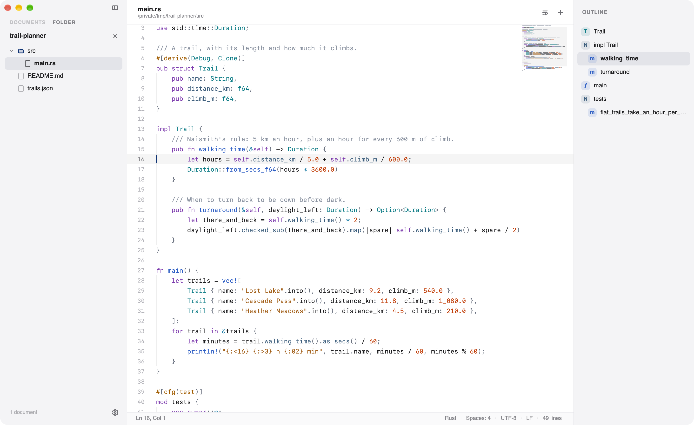
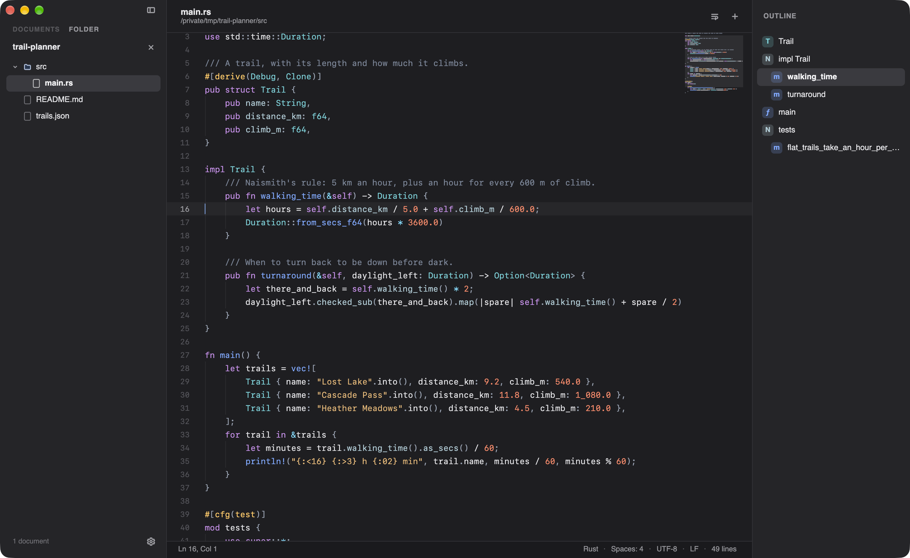
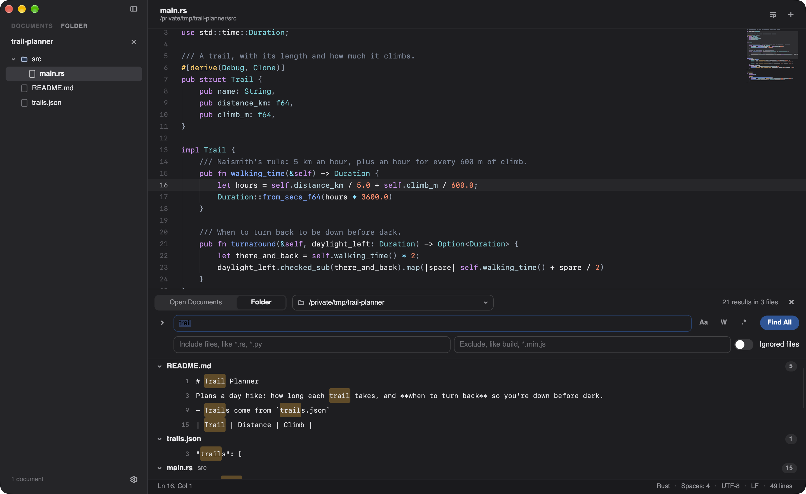
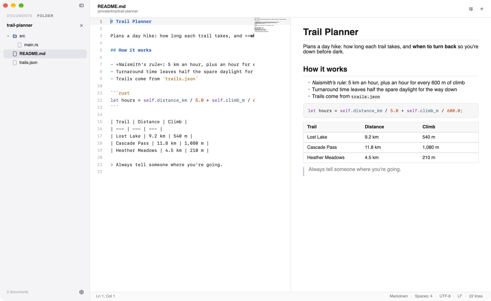
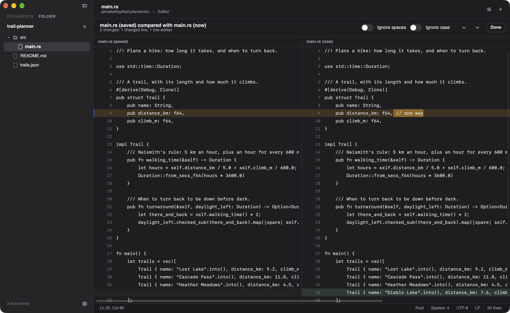
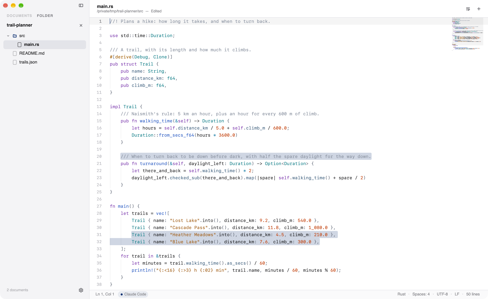
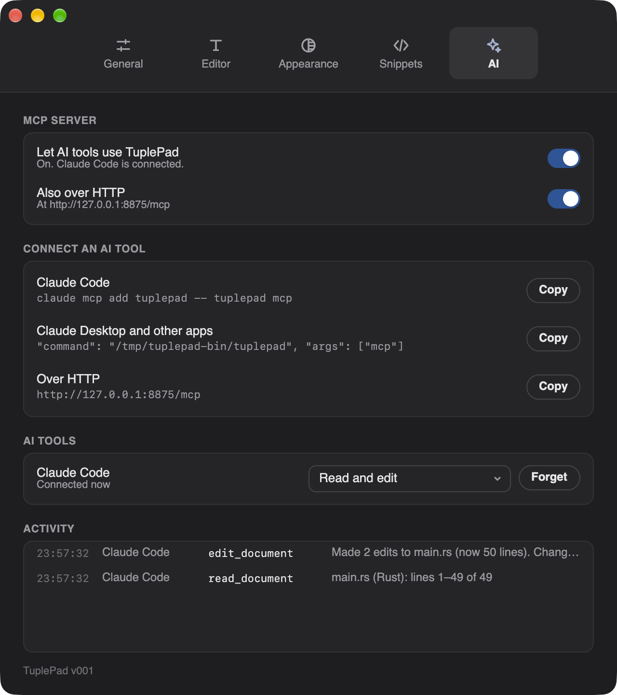
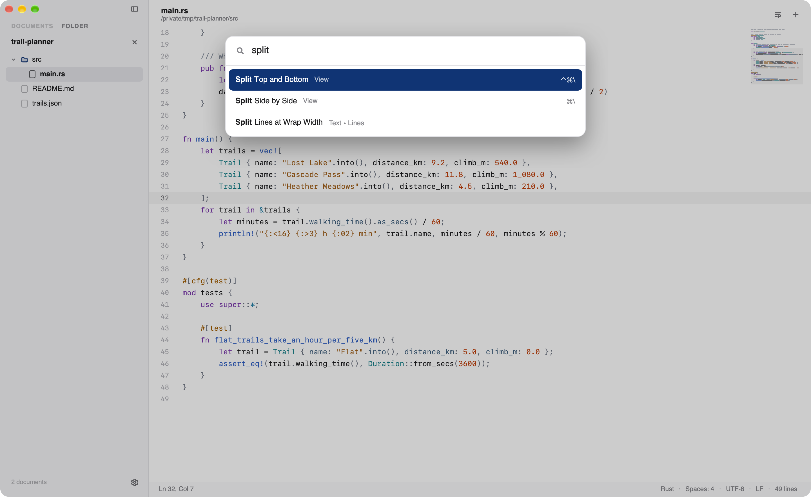
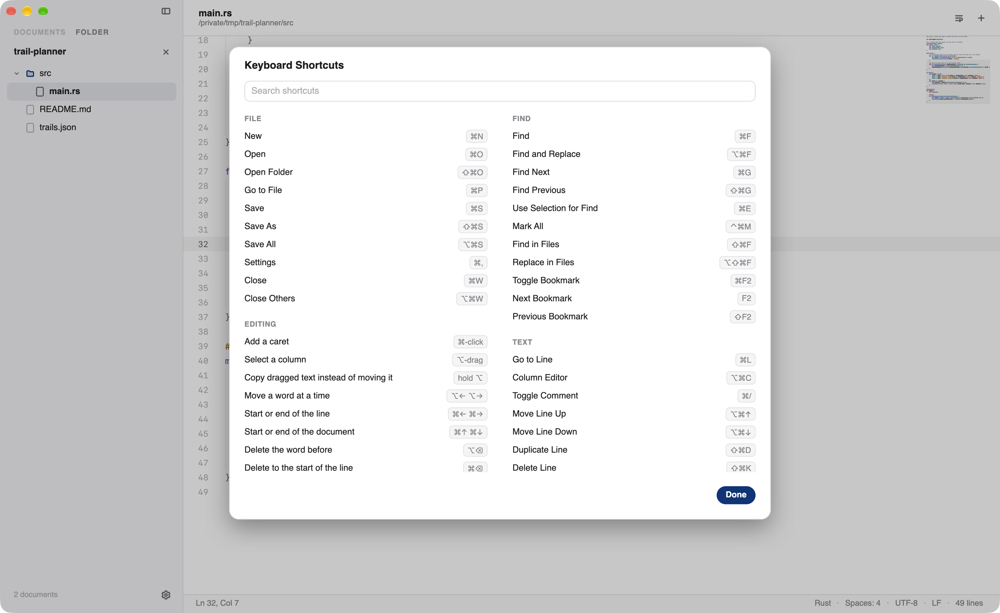

# TuplePad

A fast, beautiful text editor for Mac, Windows and Linux. Free and open source (MIT).



TuplePad is in early development; the current version is **v001**. It's built on [Slint](https://slint.dev), a cross-platform UI toolkit, so one app runs on all three systems, and the text engine is Rust. Tools that usually come as plugins are built in: Compare, JSON and XML tools, a Markdown preview, a hex view, spell check, and AI tools working in your documents while you watch.

## Features

### Editing

- **Multiple carets:** ⌃⇧↑ / ⌃⇧↓ add one above or below (Ctrl+Alt+↑/↓ on Windows and Linux), ⌘-click (Ctrl-click) adds one anywhere, ⌥-drag (Alt-drag) selects a column, and ⌘D (Ctrl+D) selects the next occurrence.
- **Code-editor basics:** brackets and quotes close automatically, Return keeps the indentation (one level deeper after an opening bracket, with the closer moved to its own line), Tab and Shift-Tab indent, Backspace steps back through indentation, smart Home, and Copy with nothing selected copies the whole line. Pasting as many lines as there are carets gives each caret one.
- **Helpful highlighting:** other occurrences of the word at the caret, the matching bracket pair, optional invisibles (spaces, tabs, line breaks) and indent guides.
- **Word wrap** (⌥Z) per document. Wrapped lines keep their indentation, and carets, selection and ↑/↓ work on the wrapped rows.
- **Input methods** for Japanese, Chinese and other languages, with the text you're composing shown in place.
- **Text menu:** Go to Line (⌘L, or type `:42` or `:42:7` in the command palette), Toggle Comment (⌘/), Move Line Up and Down (⌥⌘↑ / ⌥⌘↓), Duplicate Line (⇧⌘D) and Delete Line (⇧⌘K). **Lines:** sort four ways, reverse, remove duplicate, empty or blank lines, join (⌃⌘J) and split at the wrap width. **Case:** UPPERCASE (⌃⌘U), lowercase (⌃⌘L), Title Case, Sentence case and sWAP cASE. **Whitespace:** trim, tabs and spaces, and converting a document's indentation. Each is one undo step.
- **Column Editor** (⌥⌘C): text, or a run of numbers (start, step and repeat; decimal, hex, octal or binary; padded with zeros or spaces), down a column or at every caret, with a live preview.
- **Code folding** from the syntax tree (or indentation): the chevrons by the line numbers, ⌥⌘← and ⌥⌘→, and Fold All and Unfold All. A folded block ends in a ⋯ you can click, and moving the caret into one opens it.
- **Word completion:** after three letters, words from every open document that would finish the one you're typing. Tab or Return accepts, Esc closes.
- **Snippets:** type a trigger word and press Tab (or Insert Snippet…, ⌥⌘J), then Tab through the placeholders. Edit them in Settings.
- **Spell check** (Edit ▸ Check Spelling) of comments and strings in code, of Markdown and of plain text, with an English dictionary built in. Right-click a misspelled word for suggestions, Learn Spelling or Ignore.

### Finding things

- **Find and replace** (⌘F, ⌥⌘F; Ctrl+F, Ctrl+H on Windows and Linux): finds as you type, even in huge files, and highlights every match, the current one strongest. Match Case, Whole Words and Regular Expression options; Replace and Replace All (with `$1`-style groups) are each one undo step. ⌘G / ⇧⌘G (F3 / Shift+F3) step through matches, wrapping around, and ⌘E searches for the selection. **Count Matches**, **Mark All** (⌃⌘M) to keep every match highlighted until you clear it, and **Bookmark Matching Lines**.
- **Bookmarks:** click a line number (or ⌘F2) to bookmark a line, F2 and ⇧F2 to jump between bookmarks, and copy or delete every bookmarked line at once. Bookmarks move with your edits and come back with the session.
- **Find in Files** (⇧⌘F) and **Find in Open Documents:** a panel under the editor with results grouped by file and each match highlighted. Use ↑ and ↓ to look through them in the editor, Return to jump there. Folder searches respect `.gitignore`, skip binary and very large files (unless you include ignored files), take include and exclude patterns (`*.rs, *.py`, `build`), and show their progress with a Stop button. Searching all of TuplePad's source for `e` (50,000 matches) takes about a quarter of a second.
- **Replace in Files** (⌥⇧⌘F): first a preview of every change, file by file, with exactly what changes highlighted; uncheck any file to leave it alone. Open documents change in place (one undo step each, saved when you save), and other files are rewritten after a backup is kept, so each file can be undone, or all of them at once.
- **Folders** (Open Folder, ⇧⌘O): the sidebar switches between your open documents and a folder's files, shown as a tree that keeps up with changes on disk. Right-click a file or folder to open it, search in it, show it in Finder, copy its path or move it to the Trash. **Go to File** (⌘P) finds any file in the folder from a few letters of its name.

### Files

- **Large files.** A 500 MB, 3.8-million-line log opens in a fifth of a second, takes little more memory than its size, and scrolls at your display's full frame rate. Typing shows on screen within about 8 ms. Minified files with multi-megabyte lines draw only the part on screen.
- **Nothing is lost when you quit.** Open documents, unsaved changes and untitled notes come back on the next launch, with the caret, scroll position and word wrap where you left them.
- **Files:** New, Open, Open Recent, Save, Save As, Save All (⌥⌘S), Revert to Saved, Rename or Move, Show in Finder, and Close, Close Others and Close All, asking before closing unsaved changes. Drop files on the window to open them, and drag selected text to move it (hold ⌥ to copy).
- **Keeps up with your files.** When another app changes a file, TuplePad reloads it (Undo brings your text back), or shows a quiet banner offering Reload or Keep Mine if you have unsaved changes. Moved and deleted files get a banner too. **Follow End of File** (View menu) tails a growing log.
- **Opens anything safely.** Binary files open with a notice and a Hex View button, and control characters (like NUL) show as small marks instead of disappearing. Folders open in the sidebar. Pipes, devices and files over 4 GB are refused with a reason instead of hanging or running out of memory, and so are files you aren't allowed to read. TuplePad won't save over a read-only file, and it asks before saving a file whose bytes it couldn't all read.
- **Encodings and line endings:** detected and kept. Reopen with another encoding, convert to one (with or without a BOM; TuplePad warns about characters it can't hold), and switch line endings, from the File menu.
- **The `tuplepad` terminal command** (File ▸ Install Command Line Tool…): `tuplepad notes.txt`, `tuplepad +42 main.rs` or `main.rs:42:7`, and `git log | tuplepad -`. Files that don't exist yet open as new documents. TuplePad opens from Finder and Open With.
- **Print** (File menu) with syntax colors and line numbers (each optional), through the Mac's print panel (with its preview and Save as PDF).

### Built-in tools

- **Compare** (Tools ▸ Compare): a document with its saved version, the clipboard, or another open document, side by side. Lines line up, changed words are marked, spaces and case can be ignored, and ⌥↓ / ⌥↑ step through the changes. Long lines scroll sideways on both sides together.
- **JSON:** format, minify, sort keys, validate (pointing at the error), a tree of the document in the outline panel, and Copy Path for the value at the caret. **XML:** format, linearize, validate, and XPath queries. **CSV:** each column in its own color, Align Columns and Shrink Columns, Sort by Column, and the delimiter detected or chosen.
- **Encode and decode** the selection as Base64, URL, HTML entities, hex or quoted-printable. **Hashes:** MD5, SHA-1, SHA-256 and SHA-512 of the selection, the document or a file.
- **Markdown Preview** (⇧⌘M): the document drawn beside the editor as you type, scrolling along with it. Headings, lists, quotes, tables, images, links, and code in its own syntax colors.
- **Hex View** of a file's bytes, quick even for huge files.
- **Paste from History** (⇧⌘V) of what you've copied, **Run Shell Command** (⌃⌘R; Ctrl+Alt+R on Windows and Linux) on the selection or document, with its output replacing the text, after it, or in a new document, and **Copy with Syntax Colors** (⌥⇧⌘C) for pasting colored code into documents and email.

### Working with AI

- **AI tools can work in TuplePad** (Settings ▸ AI): Claude Code, Claude Desktop and other MCP clients can read your open documents and edit them while you watch. See [Using TuplePad with AI tools](#using-tuplepad-with-ai-tools-mcp) below.

### Look and feel

- **Syntax highlighting** for 25 languages, using the tree-sitter parser. Markdown shows emphasis, bold, code, links and headings, with fenced code blocks colored in their own language. Pick a document's language from the **Language** menu, or click the status bar to change its language, indentation, encoding or line endings.
- **A Mail-style sidebar** of open documents, showing each one's type, location and size, with a dot for unsaved changes. Hover over one for its close button, or middle-click it. Right-click for Save, Save As, Rename or Move, Show in Finder, Copy Path, Close, Close Others and Move to Trash. Drag the sidebar's edge to resize it, or hide it (⌃⌘S).
- **Themes:** TuplePad (neutral, with midnight blue), Midnight (ivory and navy), Graphite, Sepia and High Contrast, each in light and dark, following the system or pinned. Zoom with ⌘+ / ⌘− / ⌘0.
- **Settings** (⌘,): font, size and line height with a live preview; indentation; typing helpers; display options; the encoding and line endings for new documents; appearance and theme. Changes apply as you make them.
- **Command palette** (⇧⌘P): fuzzy search over every command, open document, theme and recent file, with keyboard shortcuts shown. Type a few letters (`wwr` finds Word Wrap) and press Return.
- **Keyboard Shortcuts** (Help menu, ⌥⌘/ or F1 on Windows and Linux): every shortcut on one searchable sheet, including the editing keys that aren't in the menus.
- **Outline** (⌃⌘O): functions, types and headings from the syntax tree, with the one around the caret highlighted. Click one to go there.
- **Minimap:** the document in miniature beside the scrollbar; click or drag to scroll. It's drawn once and redrawn only when what it shows changes, so it doesn't slow big files.
- **Split view** (⌘\ side by side, ⌃⌘\ top and bottom): the same document twice, each with its own carets, or two different ones. Drag the divider to resize.
- **Updates:** TuplePad looks for a new version once a day (or Help ▸ Check for Updates…) and shows what's new. Install and Relaunch downloads it, checks its signature, and reopens TuplePad with your documents, unsaved changes too. Turn the daily check off in Settings ▸ General.
- **Screen readers** (VoiceOver, Narrator and Orca): every button, switch, list and field has a name and state. The editor reads the line you're on and follows the caret as it moves, and the Markdown preview reads in order: headings, paragraphs, lists, code and tables.

## Screenshots

| | |
|---|---|
|  |  |
| Dark mode | Find in Files, grouped by file |
|  |  |
| Markdown preview beside the editor | Compare with the saved version |
|  |  |
| Claude Code's edits, highlighted as they land | Settings ▸ AI: connecting, permissions and the activity log |
|  |  |
| The command palette | Every shortcut on one sheet |

## Using TuplePad with AI tools (MCP)

TuplePad has a built-in [MCP](https://modelcontextprotocol.io) server, so AI tools can read and edit the documents you have open, including changes you haven't saved. It's off until you turn on **Let AI tools use TuplePad** in Settings ▸ AI, which also shows the exact commands below for your copy of TuplePad, with Copy buttons.

**Claude Code.** Install the `tuplepad` command (File ▸ Install Command Line Tool…), then:

```bash
claude mcp add tuplepad -- tuplepad mcp
```

**Claude Desktop** and other apps that start MCP servers themselves: add this to their MCP settings, with the path the Copy button in Settings ▸ AI gives (for Claude Desktop, Settings ▸ Developer ▸ Edit Config, then restart it):

```json
{
  "mcpServers": {
    "tuplepad": { "command": "/usr/local/bin/tuplepad", "args": ["mcp"] }
  }
}
```

`tuplepad mcp` connects to the TuplePad that's running, and starts it in the background if it isn't.

**Over HTTP.** TuplePad also serves Streamable HTTP at `http://127.0.0.1:8875/mcp` (turn off Also over HTTP in Settings ▸ AI if you don't want it):

```bash
claude mcp add --transport http tuplepad http://127.0.0.1:8875/mcp
```

What AI tools can do: list the open documents, read them (or part of a long one), see your selection, open files and create documents, make edits, find in a document or across a folder, run TuplePad's text tools (format JSON or XML, sort lines, change case, encode and decode, and the rest), and save.

What keeps you in charge:
- The first time an AI tool asks, TuplePad asks you: **Allow Editing**, **Read Only** or **Don't Allow**. Change your answer later in Settings ▸ AI.
- Edits appear live and are highlighted as they land. Each one is a single step you can undo, and your carets stay where you were typing. Nothing is saved unless the AI tool saves on purpose, and it can't save over a file that changed on disk.
- The status bar shows which AI tool is connected, and Settings ▸ AI keeps a log of everything it read and changed.
- The server listens only on this computer (a local socket and 127.0.0.1), and refuses requests from web pages.

## Download

Get TuplePad from the [Releases page](https://github.com/Baz-Studios-LLC/TuplePad/releases/latest): a disk image for the Mac (Apple silicon and Intel), an installer for Windows and an AppImage for Linux. TuplePad tells you when there's a new version and updates itself (Help ▸ Check for Updates…).

## Building it

You need Rust (from [rustup.rs](https://rustup.rs)) and, on a Mac, Xcode's command-line tools.

```bash
cargo run -p tuplepad-app --manifest-path core/Cargo.toml -- [files…]
```

`scripts/bundle-mac.sh release` makes the Mac app, `build/TuplePad.app` (add `universal` for Apple silicon and Intel in one).

## How it's built

| Part | Language | Where |
|---|---|---|
| Text engine: buffer (a rope), editing, undo, encodings, saving, syntax trees, search, session | Rust | `core/tuplepad-core` |
| Built-in tools: compare, JSON, XML, CSV, encodings, hashes, hex, Markdown, snippets, spelling | Rust | `core/tuplepad-core` |
| The app: window, editor, sidebar, menus, find bar, search panel, tool views | Slint and Rust | `core/tuplepad-app` (`ui/` and `src/`) |
| MCP server (rmcp: tools, local socket, Streamable HTTP) | Rust | `core/tuplepad-mcp` |
| `tuplepad` terminal command | Rust | `core/tuplepad-cli` |
| App icon | Icon Composer | `packaging/mac/AppIcon.icon` |

The editor draws only the lines on screen, so a document's size doesn't affect scrolling or typing speed.

## Status

TuplePad is in early development. Versions are named v001, v002, v003 and so on.

## Credits and license

TuplePad is free and open source under the [MIT license](LICENSE). The English spelling dictionary is from [SCOWL](http://wordlist.aspell.net) (see `core/tuplepad-core/dictionaries/en/LICENSE`).
